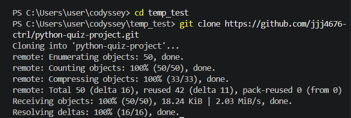
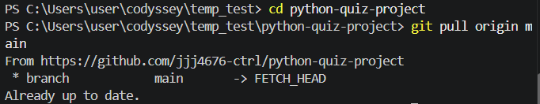

# 🐍 파이썬 기초 지식 퀴즈 게임

> **파이썬 기초 문법 학습과 데이터 영속성(Persistence), 그리고 체계적인 버전 관리를 실습하기 위한 프로젝트입니다.**

---

## 📌 프로젝트 개요
- **퀴즈 주제**: 파이썬 기초 (변수, 자료형, 제어문, 함수 등)
- **선정 이유**: 학습한 내용을 자연스럽게 복습하고, 동료 평가자에게도 파이썬의 기초를 리마인드할 수 있는 기회를 제공하기 위해서입니다.
- 이 프로젝트는 객체 지향 프로그래밍(OOP)의 기초를 다지고 JSON 파일을 활용하여 데이터를 저장/불러오기 하는 기능을 포함합니다. 또한 Git 브랜치 전략을 사용하여 기능별로 개발을 분리하고 병합하는 워크플로우를 적용했습니다.

## 🛠 주요 기능 상세
1. **퀴즈 시스템 (Game Engine)**
   - 객관식(4지선다) 문제 제공
   - 실시간 정답 확인 및 최종 점수 계산
2. **데이터 관리 (JSON Persistence)**
   - `state.json` 파일을 통해 퀴즈 데이터와 사용자 점수(Ranking)를 영구 저장
   - 프로그램 재시작 시에도 이전 데이터 유지
3. **사용자 인터페이스 (CLI Menu)**
   - **1. 게임 시작**: 저장된 퀴즈 풀기 및 점수 기록
   - **2. 퀴즈 추가**: 사용자가 직접 문제/보기/정답을 생성하여 DB 확장
   - **3. 퀴즈 목록**: 현재 등록된 모든 문제 확인
   - **4. 랭킹 확인**: 역대 플레이어들의 이름과 점수 기록 열람
   - **5. 데이터 초기화**: 랭킹 기록 삭제 기능
   - **6. 종료**: 안전하게 데이터를 저장하고 프로그램 종료

## 📸 실행 예시 (Execution Example)

### 1. 메인 메뉴 및 퀴즈 풀기
```text
==== 파이썬 기초 퀴즈 게임 ====
1. 게임 시작
2. 퀴즈 추가
3. 퀴즈 목록 보기
4. 랭킹 확인
5. 데이터 초기화
6. 종료
선택: 1

[문제 1] 파이썬에서 리스트에 요소를 추가하는 함수는?
1) push()  2) append()  3) add()  4) insert()
정답 입력: 2
✅ 정답입니다!

---

### 2단계: 비정상 종료 및 파일 I/O 예외 처리 (종합 평가 보완)

종합 평가에서 지적된 **"비정상 종료 처리"**와 **"파일 IO 예외 처리"**를 코드에 반영해야 합니다. 사용자가 `Ctrl+C`를 누르거나, `state.json` 파일이 깨져있을 때 프로그램이 튕기지 않게 만드는 것이 핵심입니다.

**[main.py 보완 가이드]**

```python
import json
import sys

class QuizGame:
    def load_data(self):
        try:
            with open("state.json", "r", encoding="utf-8") as f:
                return json.load(f)
        except FileNotFoundError:
            # 파일이 없을 때 기본 데이터 생성 (예외 처리)
            return {"quizzes": [], "ranks": []}
        except json.JSONDecodeError:
            # 파일이 손상되었을 때 처리
            print("⚠️ 데이터 파일이 손상되었습니다. 초기 상태로 시작합니다.")
            return {"quizzes": [], "ranks": []}

    def run(self):
        try:
            while True:
                # 메뉴 출력 및 로직
                pass 
        except KeyboardInterrupt:
            # Ctrl+C 비정상 종료 처리
            print("\n\n👋 프로그램을 강제 종료합니다. 데이터는 안전하게 보관됩니다.")
            self.save_data() # 종료 전 자동 저장
            sys.exit(0)

## 📝 기본 퀴즈 목록 (총 5문항)
프로그램 실행 시 기본적으로 제공되는 퀴즈 리스트입니다.

| 번호 | 주제 | 퀴즈 내용 |
| :-- | :-- | :-- |
| 1 | 자료구조 (List) | 파이썬에서 리스트에 요소를 추가하는 함수는? |
| 2 | 기초 문법 (주석) | 파이썬의 주석 기호는? |
| 3 | 입출력 (IO) | 출력할 때 사용하는 함수는? |
| 4 | 자료형 (Type) | 정수형 자료형은 무엇인가? |
| 5 | 연산자 (Operator) | 나머지를 구하는 연산자는? |

- 시험입력


## 🏗 시스템 구조 (Class Diagram)
### 1. `Quiz` 클래스
- `question`: 질문 내용
- `options`: 4개의 선택지 (List)
- `answer`: 정답 번호 (Integer)
*   **`Quiz` 클래스 (데이터 모델링)**
    *   **핵심 책임**: 개별 퀴즈의 데이터 구조를 정의하고 관리합니다.
    *   **상세 역할**: 질문(Question), 4개의 선택지(Options), 정답 번호(Answer)를 하나의 객체로 캡슐화하여 데이터의 무결성을 유지합니다.

### 2. `QuizGame` 클래스
- `load_data()`: JSON 파일 읽기 및 예외 처리
- `save_data()`: 현재 상태를 JSON으로 쓰기
- `start_game()`: 게임 루프 및 점수 처리 로직
- `add_quiz()`: 입력 유효성 검사를 포함한 퀴즈 추가
*   **`QuizGame` 클래스 (비즈니스 로직 및 제어)**
    *   **핵심 책임**: 게임의 전체적인 흐름 제어 및 데이터 영속성을 관리합니다.
    *   **상세 역할**: 퀴즈 목록 로드/저장, 사용자 입력에 따른 점수 계산, 메뉴 시스템 구동 등 게임의 핵심 실행 로직을 담당하며 UI와 데이터 사이를 중재합니다.

## 💾 데이터 구조 (JSON)
`state.json` 파일은 UTF-8 인코딩으로 아래와 같은 구조를 가집니다.
```json
{
    "quizzes": [
        {
            "question": "파이썬에서 리스트에 요소를 추가하는 함수는?",
            "options": ["push()", "append()", "add()", "insert()"],
            "answer": 2
        }
    ],
    "ranks": [
        {"name": "User1", "score": 80}
    ]
}

## 실행 방법
```bash
python main.py
git clone https://github.com/jjj4676-ctrl/python-quiz-project.git

## 파일 구조 및 데이터 설명
main.py: 프로그램 실행 및 전체 로직 관리
state.json: 퀴즈 데이터와 최고 점수를 저장하는 JSON 파일
quizzes: 문제, 선택지, 정답 번호가 포함된 리스트
best_score: 최고 점수(정답 개수)

## 예외 처리 사항
숫자 입력 오류(문자 입력, 범위 초과) 처리
빈 입력 및 공백 처리
파일 부재 또는 손상 시 복구 로직
Ctrl+C 등 비정상 종료 시 안전한 종료 및 저장
### 🛡️ 입력 검증 및 예외 처리 (Validation)
1.  **메뉴 및 정답 선택 검증**:
    *   사용자가 숫자 이외의 문자를 입력할 경우 `ValueError`를 포착하여 에러 메시지를 출력하고 재입력을 요구합니다.
    *   입력된 숫자가 지정된 범위(예: 메뉴 1~5, 정답 1~4)를 벗어날 경우, 조건문을 통해 유효성을 검사하고 다시 입력받도록 설계되었습니다.
2.  **퀴즈 추가 시 데이터 검증**:
    *   질문이나 선택지 입력 시 공백(Empty String) 여부를 확인하여 유효한 텍스트만 저장되도록 제한합니다.
    *   정답 번호는 반드시 1~4 사이의 정수여야 함을 강제합니다.

### 📋 로그 및 복구 시스템
- **데이터 저장 로그**: `save_data` 실행 시 성공 여부를 콘솔에 출력하여 데이터 영속성을 보장합니다.
- **에러 트래킹**: 저장 실패 시 구체적인 에러 메시지(`Exception`)를 출력하여 문제 원인 파악 및 복구를 용이하게 합니다.
- **데이터 로드 알림**: 프로그램 시작 시 저장된 데이터를 몇 개 불러왔는지 사용자에게 알려줍니다.
*   **파일 존재 확인**: `os.path.exists()`를 통해 `state.json` 파일이 있는지 먼저 확인합니다.
*   **읽기 실패 시 처리**:
    *   파일이 존재하지 않거나, JSON 형식이 깨져서 읽기에 실패(`json.JSONDecodeError`)할 경우, 프로그램은 중단되지 않습니다.
    *   이 경우 **코드 내에 정의된 기본 퀴즈 데이터셋(Default Dataset)을 즉시 로드**하여 사용자가 즉시 게임을 즐길 수 있도록 보장합니다.
*   **자동 복구**: 게임 종료 시 현재의 퀴즈 데이터를 다시 `state.json`으로 저장함으로써, 손상되었거나 누락된 파일을 정상적인 상태로 자동 복구합니다.

### Git 브랜치 전략
```PS C:\Users\user\codyssey\python-quiz-project> git checkout -b feature/readme-update
Switched to a new branch 'feature/readme-update'
PS C:\Users\user\codyssey\python-quiz-project> git add .
PS C:\Users\user\codyssey\python-quiz-project> git commit -m "docs: 브랜치 전략 테스트를 위한 수정"
[feature/readme-update 42ce07e] docs: 브랜치 전략 테스트를 위한 수정
 1 file changed, 3 insertions(+)
PS C:\Users\user\codyssey\python-quiz-project> git checkout main
Switched to branch 'main'
Your branch is ahead of 'origin/main' by 1 commit.
  (use "git push" to publish your local commits)
PS C:\Users\user\codyssey\python-quiz-project> git merge feature/readme-update
Updating 75e4b6d..42ce07e
Fast-forward
 README.md | 3 +++
 1 file changed, 3 insertions(+)
PS C:\Users\user\codyssey\python-quiz-project> git log --graph --oneline --all
* 42ce07e (HEAD -> main, feature/readme-update) docs: 브랜치 전략 테스트를 위한 수정
* 75e4b6d docs: 기본 퀴즈 목록 주제별 분류 추가
* f87b78a (origin/main) feat: 데이터 저장/로드 로그 시스템 구현 및 문서화
* 5d8b738 Docs: README.md 입력 검증 및 예외 처리 내용 추가
* 2d9719a Docs: README.md 실행 예시 및 비정상 종료 처리 내용 추가
* f66b27c Docs: 하위폴더 정리
* a553617 Final: 중첩 저장소 문제 해결 및 프로젝트 완성
```

### 📥 Git Clone & Pull 실습 증빙
본 프로젝트의 원격 저장소를 복제(Clone)하고 최신 상태를 유지(Pull)하는 과정을 실습하였습니다.

#### 1. Git Clone 결과


#### 2. Git Pull 결과


5. 파일 구조
main.py: 프로그램의 진입점이며 QuizGame 클래스를 실행합니다.
models.py (또는 main.py 내): Quiz, QuizGame 클래스가 정의되어 있습니다.
state.json: 퀴즈 데이터와 점수 데이터가 저장되는 JSON 파일 (UTF-8).
README.md: 프로젝트 설명서.

6. 데이터 파일 설명 (state.json)
본 프로그램은 json 모듈을 사용하여 데이터를 관리합니다.

Encoding: UTF-8
Structure:
quizzes: 퀴즈 객체들의 리스트 (질문, 보기, 정답 포함)
high_score: 현재까지 기록된 최고 점수git